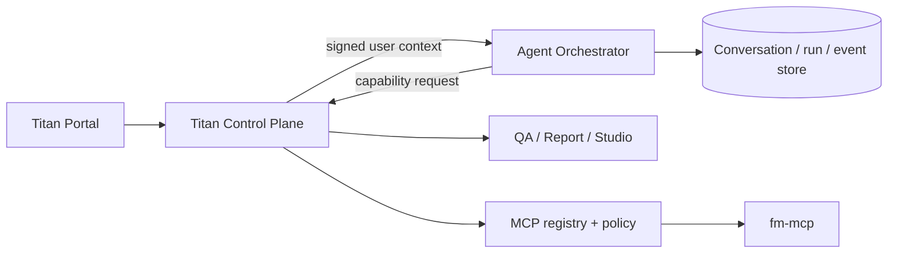
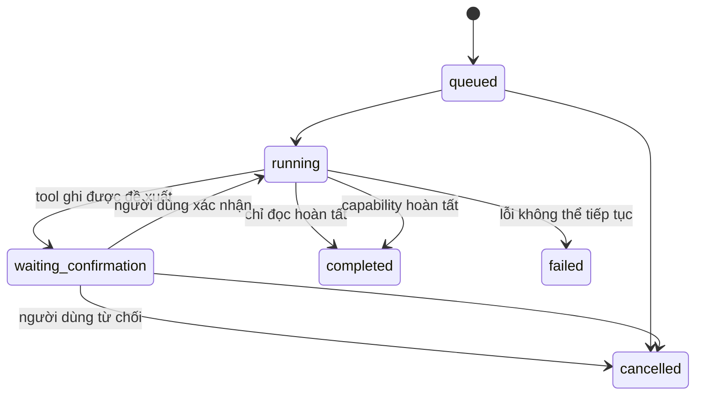

# Kiến trúc Titan Agent Orchestrator



## PlannerAgent

The orchestrator now upgrades the existing intent planner into an independent
`PlannerAgent`. It owns intent understanding, plan composition, dependency
ordering, approval boundaries, retries and result aggregation. It does not own
domain logic or MCP credentials: each task is delegated through the existing
Control Plane capability gateway, so the specialized capability owner remains
responsible for MCP/tool selection and execution.

For a multi-outcome request, the planner returns a validated `plan` on the run:

```json
{
  "id": "generated-plan-id",
  "version": 1,
  "title": "Power consumption dashboard",
  "intent": "create_dashboard",
  "status": "pending_approval",
  "tasks": [
    {
      "id": "task_analysis",
      "agent": "QAAgent",
      "capability": "data.answer_question",
      "depends_on": [],
      "requires_approval": false,
      "status": "completed"
    },
    {
      "id": "task_publish",
      "agent": "ReportAgent",
      "capability": "reports.publish_draft",
      "depends_on": ["task_draft"],
      "requires_approval": true,
      "status": "waiting_approval"
    }
  ]
}
```

Catalog entries may provide an `agent` label. Older catalogs remain compatible;
the planner derives a display-only label from the capability namespace while
routing by the catalog capability name. Plan task arguments are locally
validated against the filtered catalog and dependent values may use explicit
references such as `$task_draft.session_id`.

### Approval contract

When a protected task is next, the run has `status=waiting_confirmation`,
`type=approval_required`, and `plan.status=pending_approval`. The client sends
only the persisted plan identity and version; it never submits plan content:

```http
POST /v1/runs/{run_id}/plan/decision
Content-Type: application/json

{"decision":"approve","plan_id":"...","plan_version":1}
```

Discard uses the same endpoint with `decision=discard`. The signed principal,
tenant, plan id/version, plan status and `agent:execute` permission are checked
on the server. SQLite atomically claims the pending plan, making repeated
approve clicks idempotent. A failed plan can request a bounded replacement via
`POST /v1/runs/{run_id}/replan`; completed task results are retained when task
identities and capabilities still match.

The existing `/v1/runs/{run_id}/decision` proposal endpoint remains unchanged
for single-capability runs. The existing Titan chat UI can render a plan preview
from `run.plan` (title, description, tasks, dependencies and statuses), call the
plan decision endpoint for Approve/Discard, and continue using the existing run
and event polling endpoints for progress and final results.

Orchestrator sở hữu lifecycle của hội thoại và run. Control Plane sở hữu
identity, tenant policy, credential và execution gateway. FM MCP sở hữu
nghiệp vụ workflow. Do đó model không có quyền trực tiếp gọi database, MCP
server hoặc service credential.

## State machine


