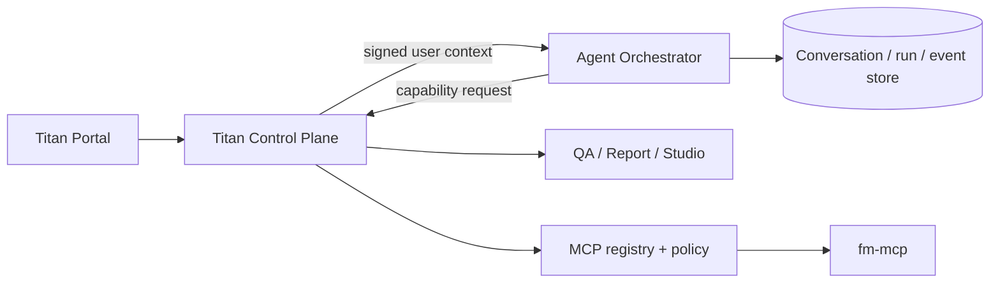
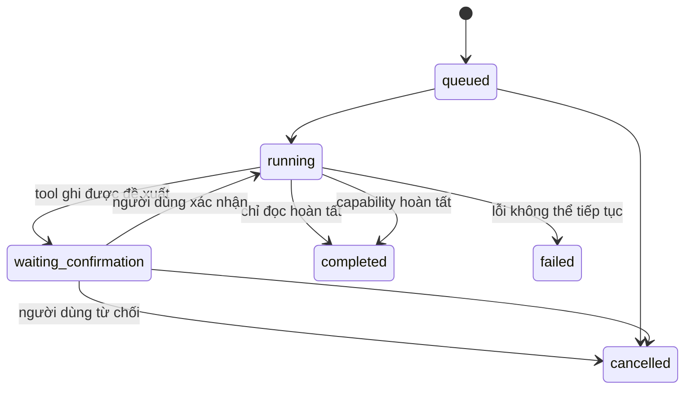

# Kiến trúc Titan Agent Orchestrator

Orchestrator sở hữu lifecycle của hội thoại và run. Control Plane sở hữu
identity, tenant policy, credential và execution gateway. FM MCP sở hữu
nghiệp vụ workflow. Do đó model không có quyền trực tiếp gọi database, MCP
server hoặc service credential.

## State machine

